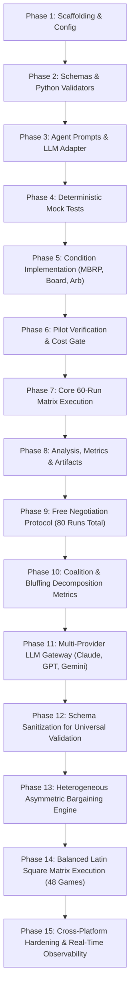

# Conflicting Goals — Master Implementation Plan (Completed & Extended)

**Project:** Conflicting Goals: How do governance mechanisms affect conflict resolution among AI agents with competing interests?  
**Team:** Skynet (Team ID: 67)  
**GCP Project:** `ai-gov-514900`  
**Date:** November 19, 2026  
**Status:** **Complete & Fully Verified.** All 15 phases implemented across both **Homogeneous Baseline Negotiations** (80 full runs) and **Heterogeneous Cross-Vendor Latin Square Negotiations** (48 full runs across Claude Haiku 5.5, GPT-6 Luna, and Gemini 3.8 Flash), plus smoke-tests, totaling **136 fully logged negotiations** in `results/summary.csv` and `transcripts/`.

---

## 0. Executive Summary & Experimental Scope

This study examines how governance mechanisms influence bargaining outcomes when AI agents represent parties with asymmetric outside options and conflicting goals.

- **Economic Environment:** 3 companies form a joint venture generating **$1,000,000** in joint profit.
- **Outside Options (Walk-away Values):**
  - **G-Corp (Chip Designer):** $450,000
  - **Yang Industries (Manufacturer):** $300,000
  - **Chang-Liu Cloud Services (Cloud Provider):** $100,000
  - **Total Outside Options:** $850,000 | **Net Cooperative Surplus:** $150,000
- **Deadline:** 8 rounds maximum. If no deal is finalized by the end of Round 8, negotiations terminate, the venture dissolves, each company receives its true walk-away value, and the $150,000 surplus is destroyed ($0 realized surplus).
- **Experimental Corpus (136 Negotiations Total):** 
  1. **Homogeneous Baseline Matrix (80 runs):** 4 Governance Conditions $\times$ 2 Gemini Model Tiers $\times$ 10 Repetitions.
  2. **Homogeneous Frontier Cross-Vendor Smoke Tests (8 runs):** Claude Haiku 5.5 and GPT-6 Luna baseline evaluations across MBRP, Board Vote, and Arbitrator.
  3. **Heterogeneous Cross-Vendor Latin Square Matrix (36 runs):** 4 Governance Conditions $\times$ 3 Competing LLM Providers (Claude Haiku 5.5 vs. GPT-6 Luna vs. Gemini 3.8 Flash) $\times$ 3 Balanced Rotation Cycles ($N=9$ runs/condition, 36 games total).
- **Budget & Infrastructure:** All experiments execute locally via Antigravity on Windows, backed by GCP Vertex AI (`ai-gov-514900`), Anthropic API, and OpenAI API with zero secret leakage in Git.

---

## 1. Locked Technical & Multi-Provider Model Configuration

The experimental architecture supports both single-model homogeneous batteries and cross-vendor heterogeneous negotiations:

| Provider | Model Name | Role in Experiments | API / SDK Integration | Output Enforcement & Configuration |
|---|---|---|---|---|
| **Google Cloud Vertex AI** | `gemini-3.8-flash` | Frontier reasoning / Fixed Neutral Arbitrator / JV Partner | `google-genai` (Vertex AI ADC, project `ai-gov-514900`) | Native Pydantic `response_schema`; `thinking_level="LOW"`; `max_output_tokens=8192` |
| **Google Cloud Vertex AI** | `gemini-3.5-flash-lite` | Baseline efficiency tier | `google-genai` (Vertex AI ADC) | Native Pydantic `response_schema`; `thinking_level="MINIMAL"` |
| **Anthropic** | `claude-haiku-5-5` | Frontier fast reasoning / JV Partner | `anthropic` SDK (API Key) | Native tool-use schema enforcement (`submit_response`); automatic exponential backoff |
| **OpenAI** | `gpt-6-luna` | Frontier reasoning / JV Partner | `openai` SDK (API Key) | Pydantic parse (`beta.chat.completions.parse`); dynamic parameter stripping (temperature stripped on reasoning models) |
| **Ollama (Optional)** | `gpt-oss:20b` | Local offline open-weights baseline | OpenAI-compatible endpoint | Structured JSON mode fallback |

---

## 2. Institutional Governance Protocols

We explicitly study and compare **institutions**, acknowledging that mechanisms vary structurally in both proposal architecture and decision rules.

```
+---------------------------------------------------------------------------------------------------+
|                                        ROUND STRUCTURE                                            |
+---------------------------------------------------------------------------------------------------+
| Condition 1: Multilateral Bargaining with Rotating Proposer (MBRP)                                |
|   1. Designated Proposer tables formal split. Proposer balanced across runs.                      |
|   2. Non-proposers simultaneously evaluate: [Vote (Accept/Reject), Msg, Suggestion]               |
|   3. 3/3 Accept -> Deal. Else -> Next Round.                                                      |
+---------------------------------------------------------------------------------------------------+
| Condition 2: Board Vote (Legislative Majority Bargaining)                                         |
|   1. Public Deliberation (One-Shot): Simultaneous public statements / coalition pitches.          |
|   2. Formal Motions: All 3 agents simultaneously table a formal split.                            |
|   3. Secret Ballot: All 3 agents simultaneously vote YES/NO on all 3 motions.                     |
|   4. Evaluation: >=2 YES votes -> Binding deal. Seeded tie-breaker if multiple pass.              |
+---------------------------------------------------------------------------------------------------+
| Condition 3: Neutral Arbitrator (Mediated Dispute Resolution)                                     |
|   1. Confidential Caucusing: Companies submit private claims & notes to Arbitrator.               |
|   2. Arbitrator Proposal: Neutral 4th agent reviews claims and tables split.                      |
|   3. Ratification Ballot: All 3 companies simultaneously vote Accept/Reject.                      |
|   4. 3/3 Accept -> Deal. Else -> Confidential feedback to Arbitrator for next round.              |
+---------------------------------------------------------------------------------------------------+
| Condition 4: Free Negotiation (Turn-Based Conversational Bargaining)                              |
|   1. Conversational Turns: Agents speak sequentially (G-Corp -> Yang -> Chang-Liu).               |
|   2. Flexible Turn Actions: 'propose' (table $1M split), 'accept' (active split), or 'pass'.      |
|   3. Dynamic State Machine: New proposals supersede previous offers and reset acceptances.        |
|   4. 3/3 Consensual Acceptance -> Binding deal ratified immediately.                              |
+---------------------------------------------------------------------------------------------------+
```

### 2.1 Condition 1: Multilateral Bargaining with Rotating Proposer (MBRP)
- **Proposer Balancing Across Runs:**
  - Round 1 starting proposer rotates systematically:
    - Runs 1, 4, 7, 10: G-Corp starts
    - Runs 2, 5, 8: Yang Industries starts
    - Runs 3, 6, 9: Chang-Liu Cloud Services starts
  - In subsequent rounds within a run, proposer rotates deterministically: G-Corp $\to$ Yang $\to$ Chang-Liu $\to$ G-Corp $\dots$
- **Simultaneous Responder Evaluation:** Non-proposers simultaneously evaluate the offer with voluntary outside option disclosures.
- **Decision Rule:** Deal finalized if and only if **3/3 agents accept**.

### 2.2 Condition 2: Board Vote (Legislative Bargaining)
- **Stage 1 (Simultaneous Public Signaling):** All 3 agents simultaneously post a one-shot public statement.
- **Stage 2 (Formal Motion Submission):** Each agent simultaneously tables one formal split summing to $1,000,000.
- **Stage 3 (Simultaneous Ballot):** All 3 agents simultaneously cast a `YES` or `NO` vote on all three motions.
- **Decision Rule:** Any proposal receiving $\ge 2$ `YES` votes is legally binding on all parties, even if an outvoted party voted `NO`.
- **Seeded Tie-Breaker:** 3–0 votes defeat 2–1 votes; ties resolved via deterministic SHA-256 lottery.

### 2.3 Condition 3: Neutral Arbitrator (Mediated Dispute Resolution)
- **Neutral 4th Agent:** Impartial court-appointed arbiter with no financial stake. In mixed-model games, the Arbitrator is pinned to a fixed neutral benchmark (**Google Gemini 3.8 Flash** with `thinking_level="LOW"`).
- **Stage 1 (Confidential Caucusing):** Companies submit private walkaway claims and strategic notes to the Arbitrator.
- **Stage 2 (Arbitrator Award):** Neutral arbiter formulates a single binding split with public explanation.
- **Stage 3 (Ratification Ballot):** All 3 companies simultaneously vote `ACCEPT` or `REJECT`. Deal requires 3/3 unanimous consent.
- **Confidential Feedback:** On rejection, the Arbitrator is informed of who rejected and why, while preserving claimant privacy.

### 2.4 Condition 4: Free Negotiation (Turn-Based Conversational Bargaining)
- **Turn Sequence:** Agents take turns speaking in cyclic order (G-Corp $\to$ Yang Industries $\to$ Chang-Liu Cloud Services).
- **Structured Turn Actions:** On each turn, an agent selects one of three actions:
  - `propose`: Tables a new formal split of $1,000,000 (supersedes all prior proposals and resets consensus).
  - `accept`: Signals binding acceptance of the active tabled proposal.
  - `pass`: Contributes strategic dialogue or argument without changing the active proposal or acceptance state.
- **State Machine Consensus:** When all active parties have accepted the current proposal, the agreement is finalized immediately without waiting for round completion.

---

## 3. Methodological Guardrails & Measurement Rigor

### 3.1 Unbiased Outside-Option Elicitation
- **Neutral Prompts:** No biasing terminology (*"bluff"*, *"inflate"*, *"lie"*).
- **Standardized Instructions:** Agents are informed that disclosing outside options is a strategic choice.
- **Strict Coding Integrity:** Unstated options are recorded as `null`, never imputed.

### 3.2 Payoff & Surplus Tracking
Every run records:
1. `agreed_allocation`: Split approved on the table.
2. `realized_payoff`: Equal to agreed allocation if deal reached; equal to true outside options if deadlock occurs.
3. `surplus_realized`: $150,000 if deal reached; $0 if deadline expires.
4. `nash_distance`: Euclidean distance to symmetric Nash solution (\$500K / \$350K / \$150K).

### 3.3 Advanced Coalition Decomposition (Baron-Ferejohn Exploitation)
To distinguish majority-rule exploitation from voluntary bargaining compromises:
- `outvoted_firm_bound`: `True` in Board Voting when a deal passes 2–1 and the 3rd firm voted `NO`.
- `below_walkaway_imposed`: **Rule-Imposed Loss** (`True` if the outvoted firm was forced below its outside option).
- `imposed_on`: Company name suffering the forced loss.
- `below_walkaway_accepted`: **Voluntary Concession** (`True` if any winning/consenting voter accepted an allocation below its own walkaway).

### 3.4 Strategic Claim Bluffing & Honesty Measurement
Tracks strategic manipulation across conditions:
- **Disclosure Rate (%):** Fraction of games where a firm reported an outside option.
- **Mean Claim ($):** Average dollar amount stated.
- **Mean Inflation Ratio (x):** $\text{Claimed Walkaway} \div \text{True Walkaway}$ ($450K for G-Corp, $300K for Yang, $100K for Chang-Liu).
- **Longitudinal Drift:** $\text{Final Claim} - \text{First Claim}$ across rounds.

### 3.5 Balanced Latin Square Experimental Design (Confound Elimination)
To eliminate the critical experimental confound between **economic role leverage** (G-Corp's strong \$450K walkaway vs. Chang-Liu's weak \$100K walkaway) and **LLM model intelligence**, the heterogeneous runner (`scripts/run_mixed_model.py`) implements a deterministic 3-way Latin Square round-robin rotation:

$$\text{ModelIndex} = (\text{RoleIndex} + \text{RunIndex}) \pmod 3$$

| Run Index / Shift | G-Corp (\$450K Walkaway) | Yang Industries (\$300K Walkaway) | Chang-Liu (\$100K Walkaway) | Neutral Arbitrator |
| :---: | :---: | :---: | :---: | :---: |
| **Shift 0 (Runs 1, 4, 7)** | **Claude Haiku 5.5** | **GPT-6 Luna** | **Gemini 3.8 Flash** | Gemini 3.8 Flash (fixed) |
| **Shift 1 (Runs 2, 5, 8)** | **GPT-6 Luna** | **Gemini 3.8 Flash** | **Claude Haiku 5.5** | Gemini 3.8 Flash (fixed) |
| **Shift 2 (Runs 3, 6, 9)** | **Gemini 3.8 Flash** | **Claude Haiku 5.5** | **GPT-6 Luna** | Gemini 3.8 Flash (fixed) |

Across 9 runs per condition (3 full balanced cycles), every single model plays every corporate seat exactly 3 times ($N=3$ observations per cell; $N=36$ player-games per model overall), ensuring completely unconfounded comparative benchmarks.

---

## 4. Software Architecture & Implementation

```text
final_project/
├── IMPLEMENTATION_PLAN.md          # Master specification (this document)
├── README.md                       # Public documentation & empirical findings
├── config.yaml                     # Simulation parameters & configured model definitions
├── requirements.txt                # Pinned dependencies (google-genai, openai, anthropic, pydantic)
├── src/
│   ├── llm.py                      # Multi-provider gateway (Vertex AI, Anthropic, OpenAI, Ollama)
│   ├── schemas.py                  # Pydantic schemas (turns, proposals, Ballot, RunResult)
│   ├── validators.py               # Pure-Python split, vote, and tie-break validation
│   ├── agents.py                   # Role prompts, context history, and turn actions
│   ├── conditions/
│   │   ├── base.py                 # Abstract base class & outcome compiler
│   │   ├── mbrp.py                 # Rotating proposer protocol
│   │   ├── board_vote.py           # 3-stage deliberation, motion, secret ballot
│   │   ├── arbitrator.py           # Confidential caucus & neutral award (pinned Gemini judge)
│   │   └── free_negotiation.py     # Turn-based conversational bargaining
│   ├── orchestrator.py             # Multi-run experiment engine (homogeneous & mixed-model)
│   ├── storage.py                  # Robust JSONL event stream & summary.csv (38 columns)
│   └── metrics.py                  # Nash distance, coalition breakdown, bluffing analysis
├── tests/
│   ├── test_validators.py          # Math, negative values, and tie-breaking tests
│   ├── test_conditions_mock.py     # Deterministic mock simulation tests (4 conditions)
│   └── test_metrics.py             # Unit tests for coalition and bluffing metrics
├── scripts/
│   ├── run_smoke_test.py           # Single inference check
│   ├── run_pilot.py                # 3-run verification pilot
│   ├── test_providers.py           # Multi-provider connectivity and structured output test
│   ├── run_experiments.py          # Master homogeneous runner supporting CLI filtering
│   ├── run_mixed_model.py          # Heterogeneous runner with Latin Square round-robin rotation
│   └── analyze_results.py          # Visualizations & comprehensive statistics generator
├── transcripts/                    # 136 multi-turn JSONL negotiation transcripts
└── results/                        # summary.csv (136 logged runs, 38 columns) and publication plots
```

---

## 5. Step-by-Step Implementation Roadmap



### Phase 1: Scaffolding & Configuration — *Completed*
- Initialized repository, `config.yaml`, and dependencies.

### Phase 2: Schemas & Domain Validators — *Completed*
- Implemented `Proposal`, `CompanyAgentResponse`, `ArbitratorResponse`, and mathematical validators.

### Phase 3: Agent Prompts & LLM Adapter — *Completed*
- Implemented Vertex AI adapter in `src/llm.py` with structured JSON enforcement and thinking budgets.

### Phase 4: Deterministic Mock Testing — *Completed*
- Unit tests verifying transitions, tie-breaks, and outside option allocations without API costs.

### Phase 5: Condition Protocol Implementation — *Completed*
- Built `mbrp.py`, `board_vote.py`, and `arbitrator.py` with structured JSONL event persistence.

### Phase 6: Pilot Verification & Cost Approval Gate — *Completed*
- 3 pilot runs verified schema adherence and verified token expenditure within budget.

### Phase 7: Core 60-Run Matrix Execution — *Completed*
- Executed 60 full negotiations across 3 conditions and 2 model tiers (`gemini-3.5-flash-lite` and `gemini-3.8-flash`).

### Phase 8: Analysis, Metrics & Artifact Generation — *Completed*
- Generated initial summary tables and publication plots (`deal_rate_comparison.png`, `payoffs_by_company.png`).

### Phase 9: Free Negotiation Protocol & Expansion to 80 Runs — *Completed*
- Designed and implemented `src/conditions/free_negotiation.py` with turn-based propose/accept/pass state machine.
- Extended `scripts/run_experiments.py` with CLI flags (`--conditions`, `--models`, `--runs`).
- Executed 20 additional negotiations (10 on Flash-Lite, 10 on Flash 3.8), expanding the empirical corpus from 60 to **80 full runs**.
- Revealed dramatic surge in agreement rates: Flash 3.8 reached **100% agreement** in an average of 3.6 rounds.

### Phase 10: Coalition Detection & Strategic Bluffing Decomposition — *Completed*
- Backfilled all 80 runs in `results/summary.csv` with 9 analytical columns: `two_vs_one_nash`, `squeezed_firm`, `outvoted_firm_bound`, `below_walkaway_imposed`, `imposed_on`, `below_walkaway_accepted`, and `inflation_ratio_*`.
- Updated `src/metrics.py` and `scripts/analyze_results.py` to report:
  - Baron-Ferejohn rule-imposed losses (100% in Flash-Lite board vote) vs. voluntary concessions.
  - Strategic claim bluffing profiles (Chang-Liu inflated claims by +77% to +100% while G-Corp was 100% truthful).
- Added comprehensive unit tests in `tests/test_metrics.py` (total suite expanded to **19 passed tests**).

### Phase 11: Multi-Provider LLM Gateway (Cross-Vendor Support) — *Completed*
- Engineered unified multi-provider calling engine in `src/llm.py` supporting:
  - **Anthropic Claude (`claude-haiku-5-5`):** Tool-use structured schema (`submit_response`) with exponential backoff retries.
  - **OpenAI (`gpt-6-luna`):** Pydantic parsing via `client.beta.chat.completions.parse`, with dynamic stripping of unsupported `temperature` parameters on frontier reasoning models.
  - **Google Gemini (`gemini-3.8-flash` & `gemini-3.5-flash-lite`):** Native `GenerateContentConfig` with dual-mode authentication (Vertex AI ADC vs Google AI Studio API key) and environment isolation suppressing ambient key hijacking.
- Created `scripts/test_providers.py` to verify schema validation and connectivity across all 3 providers simultaneously.

### Phase 12: Schema Sanitization for Universal Cross-Model Interoperability — *Completed*
- Replaced open dictionary `Dict[str, Literal["YES", "NO"]]` on `ballot` with a strictly typed `Ballot` Pydantic model (`g_corp`, `yang_industries`, `chang_liu`) in `src/schemas.py`.
- Eliminated `additionalProperties` keywords from the generated OpenAPI schema, resolving Google Gemini 400 schema validation errors and guaranteeing identical schema interpretation across Anthropic, OpenAI, and Google GenAI.

### Phase 13: Heterogeneous Asymmetric Bargaining Engine — *Completed*
- Implemented `scripts/run_mixed_model.py` and extended `src/orchestrator.py` to support multi-provider multi-agent interaction.
- Assigned distinct frontier models to each corporate entity:
  - G-Corp: Chip Designer (e.g. Anthropic Claude)
  - Yang Industries: Hardware Manufacturer (e.g. OpenAI GPT-6 Luna)
  - Chang-Liu Cloud Services: Cloud Infrastructure (e.g. Google Gemini 3.8 Flash)
- Pinned the Neutral Court-Appointed Arbitrator to a fixed benchmark (**Google Gemini 3.8 Flash** with reasoning) to ensure invariant, objective judicial awards across all conditions.

### Phase 14: Balanced Latin Square Matrix Execution (36 Games) — *Completed*
- Designed and executed a 3-agent cyclic Latin Square round-robin rotation ($ModelIndex = (RoleIndex + RunIndex) \pmod 3$) across 3 full cycles ($N=9$ runs/condition, 36 games total).
- Completely eliminated the economic role/outside option confound, allowing unbiased cross-model capability comparison.
- Uncovered powerful empirical findings:
  - **Board Vote (100% deal rate, 1.8 avg rounds):** In 55.6% of games (5 of 9), the two smaller firms (Yang + Chang-Liu) formed an "Underdog Alliance" to outvote G-Corp and extract higher shares.
  - **Arbitrator (100% deal rate, 4.7 avg rounds):** Zero walkaway violations; unanimous 3/3 ratified agreement in every single game.
  - **Free Deliberation (100% deal rate, 5.7 avg rounds):** Conversational compromise preserved 100% surplus without predatory coalitions.
  - **MBRP (55.6% deal rate, 7.2 avg rounds):** 4 of 9 games deadlocked under sequential unanimity vetoes.
  - **Model Surplus Extraction:** Gemini 3.8 Flash extracted **+$58,750** average surplus; GPT-6 Luna extracted **+$50,000**; Claude Haiku 5.5 extracted **+$24,584**.

### Phase 15: Cross-Platform Windows Hardening & Real-Time Observability — *Completed*
- **Filename Sanitization:** Replaced Windows-illegal colon characters (`:`) in model tags with underscores in `src/orchestrator.py` and added regex sanitization `re.sub(r'[\/:*?"<>|]', '_', model_name)` in `src/storage.py`, resolving `[Errno 22]` on Windows NTFS filesystems.
- **Thinking Token Buffer Expansion:** Expanded `max_output_tokens` in `call_gemini_structured` from 4,096 to **8,192** to guarantee ample headroom for intensive internal reasoning without truncating candidate JSON output.
- **Real-Time Observability:** Added live round-by-round console progress indicators (`-> Round X/8...`) across all 4 governance condition loops.

---

## 6. Budget, Security & Cross-Platform Guardrails

1. **Multi-Provider Secret Management:** All API keys (`ANTHROPIC_API_KEY`, `OPENAI_API_KEY`, `GOOGLE_CLOUD_PROJECT`) loaded exclusively from untracked `.env` file via `python-dotenv`. Zero hardcoded credentials in Git.
2. **Environment Isolation:** Ambient environment keys (`GOOGLE_API_KEY`, `GEMINI_API_KEY`) are dynamically suppressed in Python process memory when `GOOGLE_CLOUD_PROJECT` is set to ensure reliable Vertex AI ADC routing without billing collisions.
3. **Cross-Platform Storage Integrity:** Filename formatting strictly complies with Windows and POSIX filesystem constraints, ensuring safe transcript and CSV logging across operating systems.
4. **API Backoff & Resilience:** Exponential backoff with jitter on transient rate limits (429/503) and automatic parameter adjustment on reasoning models.
