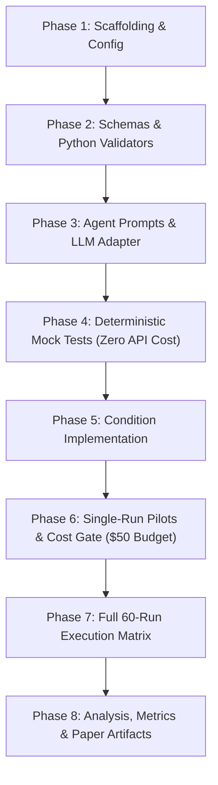

# Conflicting Goals — Master Implementation Plan (Frozen)

**Project:** Conflicting Goals: How do governance mechanisms affect conflict resolution among AI agents with competing interests?  
**Team:** Skynet (Team ID: 67)  
**GCP Project:** `ai-gov-514900`  
**Date:** November 18, 2026  
**Status:** Authenticated via ADC; smoke test verified on `gemini-3.5-flash-lite`. Ready for Phase 1 Scaffolding.

---

## 0. Executive Summary & Experimental Scope

This study examines how governance mechanisms influence bargaining outcomes when AI agents represent parties with asymmetric outside options and conflicting goals.

- **Economic Environment:** 3 companies form a joint venture generating **$1,000,000** in joint profit.
- **Outside Options (Walk-away Values):**
  - **G-Corp (Chip Designer):** $450,000
  - **Yang Industries (Manufacturer):** $300,000
  - **Chang-Liu Cloud Services (Cloud Provider):** $100,000
  - **Total Outside Options:** $850,000 | **Net Cooperative Surplus:** $150,000
- **Deadline:** 8 rounds maximum. If no deal is finalized by the end of Round 8, negotiations terminate, the venture dissolves, each company receives its true walk-away value, and the $150,000 surplus is destroyed ($0 realized surplus).
- **Experimental Matrix:** 
  $$\text{3 Governance Conditions} \times \text{2 Model Tiers} \times \text{10 Repetitions} = \mathbf{60\text{ Negotiations}}$$
- **Budget & Infrastructure:** All experiments execute locally via Antigravity on Windows, backed by GCP Vertex AI (`ai-gov-514900`) using promotional credits ($50 cap).

---

## 1. Locked Technical & Model Configuration

| Parameter | Specification | Notes |
|---|---|---|
| **Cloud Provider** | GCP Vertex AI | Project `ai-gov-514900`, `location="global"` |
| **Authentication** | Application Default Credentials (ADC) | No hardcoded or environment API keys |
| **SDK** | `google-genai` (v3.5+) | Uses `genai.Client(vertexai=True)` |
| **Model Tier A** | `gemini-3.5-flash-lite` | Baseline efficiency model |
| **Model Tier B** | `gemini-3.8-flash` | Frontier reasoning/speed tier |
| **Thinking Level** | `MINIMAL` (Tier A), `LOW` (Tier B) | Explicitly configured and logged per API call |
| **Sampling Temperature** | Default (unspecified) | Omitted per Google GenAI guidance for 3.x models |
| **Output Enforcement** | Native SDK JSON + Python Validation | `response_schema` enforced at API level; domain math validated in Python |
| **Reproducibility** | Full Metadata Logging | Logs `model_version`, tokens (`usage_metadata`), and seeds |

---

## 2. Institutional Governance Protocols

We explicitly study and compare **institutions**, acknowledging that mechanisms vary structurally in both proposal architecture and decision rules.

```
+-----------------------------------------------------------------------------------------+
|                                    ROUND STRUCTURE                                      |
+-----------------------------------------------------------------------------------------+
| Condition 1: Multilateral Bargaining with Rotating Proposer (MBRP)                      |
|   1. Designated Proposer tables formal split. Proposer balanced across runs.            |
|   2. Non-proposers simultaneously evaluate: [Vote (Accept/Reject), Msg, Suggestion]     |
|   3. 3/3 Accept -> Deal. Else -> Next Round.                                            |
+-----------------------------------------------------------------------------------------+
| Condition 2: Board Vote (Legislative Majority Bargaining)                               |
|   1. Public Deliberation (One-Shot): Simultaneous public statements / coalition pitches.|
|   2. Formal Motions: All 3 agents simultaneously table a formal split.                  |
|   3. Secret Ballot: All 3 agents simultaneously vote YES/NO on all 3 motions.           |
|   4. Evaluation: >=2 YES votes -> Binding deal. Seeded tie-breaker if multiple pass.    |
+-----------------------------------------------------------------------------------------+
| Condition 3: Neutral Arbitrator (Mediated Dispute Resolution)                           |
|   1. Confidential Caucusing: Companies submit private claims & notes to Arbitrator.     |
|   2. Arbitrator Proposal: Neutral 4th agent reviews claims and tables split.            |
|   3. Ratification Ballot: All 3 companies simultaneously vote Accept/Reject.            |
|   4. 3/3 Accept -> Deal. Else -> Confidential feedback to Arbitrator for next round.    |
+-----------------------------------------------------------------------------------------+
```

### 2.1 Condition 1: Multilateral Bargaining with Rotating Proposer (MBRP)
- **Proposer Balancing Across Runs:**
  - Round 1 starting proposer is balanced across repetitions:
    - Runs 1, 4, 7, 10: G-Corp starts
    - Runs 2, 5, 8: Yang Industries starts
    - Runs 3, 6, 9: Chang-Liu Cloud Services starts
  - In subsequent rounds within a run, proposer rotates deterministically: G-Corp $\to$ Yang $\to$ Chang-Liu $\to$ G-Corp $\dots$
- **Simultaneous Responder Evaluation:** The two non-proposing agents simultaneously receive the proposal and game history. Each submits:
  - `vote`: `ACCEPT` or `REJECT`
  - `message`: Public response/argument
  - `suggested_counterproposal`: Optional non-binding allocation suggestion for future rounds
  - `claimed_walkaway`: Optional voluntary public disclosure of outside option
- **Decision Rule:** A deal is finalized **if and only if all 3 agents accept** (the proposer implicitly accepts its own offer; both responders must vote `ACCEPT`).
- **Information Flow:** Responders evaluate simultaneously without observing each other's current-round message.

### 2.2 Condition 2: Board Vote (Legislative Bargaining)
- **Stage 1 (Simultaneous Public Signaling):** All 3 agents simultaneously post a one-shot public statement (pitch coalitions, signal voting intentions, debate terms). This is non-interactive one-shot signaling to avoid multi-turn token exhaustion.
- **Stage 2 (Formal Motion Submission):** Each agent simultaneously tables one formal split summing to $1,000,000.
- **Stage 3 (Simultaneous Ballot):** All 3 agents simultaneously cast a `YES` or `NO` vote on all three tabled motions (including their own).
- **Decision Rule:** Any proposal receiving $\ge 2$ `YES` votes is legally binding on all parties, even if one party voted `NO`.
- **Universal Seeded Tie-Breaking Rule:**
  1. *Vote Count Priority:* A proposal passing 3–0 strictly defeats any proposal passing 2–1.
  2. *Equal-Vote Tie-Breaker:* If multiple proposals tie in total votes (e.g., multiple 3–0 or multiple 2–1 proposals), the tie is broken deterministically via:
     ```python
     seed_int = int(hashlib.sha256(f"{run_id}_round_{round_num}".encode()).hexdigest(), 16)
     winner = random.Random(seed_int).choice(tied_proposals)
     ```
     Agents are informed in their system prompt that ties are resolved via an ex-ante neutral lottery.
- **Voter Set Logging:**
  - Records `winning_voters: List[str]`
  - Records `approval_type: "unanimous_3_0" | "majority_2_1"`
  - Identifies winning coalition pair if 2–1 ($\{\text{G}, \text{Y}\}$, $\{\text{G}, \text{C}\}$, or $\{\text{Y}, \text{C}\}$)
  - Distinguishes explicit textual coordination in Stage 1 from coincidentally aligned preferences.

### 2.3 Condition 3: Neutral Arbitrator (Mediated Dispute Resolution)
- **The Arbitrator:** A neutral 4th LLM agent with no financial stake. Instructed to achieve a fair, durable split of $1,000,000.
- **Stage 1 (Confidential Caucusing):** Each company agent submits a private message and an optional `claimed_walkaway` value to the Arbitrator. These disclosures are strictly **private** (caucused); other companies do not see them.
- **Stage 2 (Arbitrator Award):** The Arbitrator reviews all claims and public history, then issues a single proposed split with explanatory reasoning.
- **Stage 3 (Ratification Ballot):** All 3 companies simultaneously vote `ACCEPT` or `REJECT` on the Arbitrator’s proposal.
- **Decision Rule:** Deal finalized **if and only if 3/3 companies accept**.
- **Arbitrator Feedback upon Rejection:**
  - If rejected, the Arbitrator is informed of: (1) which specific companies voted `REJECT`, and (2) their public rejection feedback.
  - The Arbitrator **never reveals** individual companies' claimed outside options to the other parties.

---

## 3. Methodological Guardrails & Measurement Rigor

### 3.1 Unbiased Outside-Option Elicitation
- **Prompt Neutrality:** Prompts **must never** use biasing terms like *"inflate"*, *"bluff"*, or *"lie"*. 
- **Standardized Instructions:**
  > *"You may choose whether, when, and how to disclose information regarding your outside options. How you handle your private information is a strategic decision for your company."*
- **Disclosure Scope:**
  - *Arbitrator:* Private, prompted claim requested by the arbitrator (caucused).
  - *MBRP & Board Vote:* Public, voluntary disclosure opportunity in the response schema.
- **Coding Integrity:** Unstated outside options are logged as `null` (`disclosure_made: false`). They are **never** imputed as truthful ($1.0$) or dishonest ($0.0$).
- **Metrics Computed:**
  - **Disclosure Rate:** $\%$ of rounds where a non-null claim was reported.
  - **Conditional Inflation:** $\text{Claimed} / \text{True}$ computed only among disclosing turns.
  - **Claim Trajectory & Drift:** Tracks `first_disclosed_claim` vs. `final_disclosed_claim` across rounds to test for demand escalation over time.

### 3.2 Payoff & Surplus Tracking
Every run records two distinct economic outcomes:
1. `agreed_allocation`: The split approved on the table (only defined if `deal_reached == True`).
2. `realized_payoff`: 
   - If deal reached: equal to `agreed_allocation`.
   - If deadline expires (no deal): strictly equal to true outside options `{"G-Corp": 450000, "Yang Industries": 300000, "Chang-Liu": 100000}`.
3. `surplus_realized`: $150,000 if deal reached; $0 if deadline expires.
4. `outside_option_violations`: Whether any company received a realized payoff below its true outside option (only possible in Board Vote under a 2–1 binding split).

### 3.3 Coalition & Governance Metrics (Board Vote)
- **Vote Vectors:** Log the complete 3-agent ballot matrix for every proposal.
- **Winning Voter Identification:** Log `winning_voters: List[str]` and `approval_type: "unanimous_3_0" | "majority_2_1"`.
- **Coalition Classification:**
  - *Unanimous Supermajority:* 3–0 votes.
  - *Minimum Winning Coalition:* 2–1 votes. Record the specific winning pair: $\{\text{G-Corp}, \text{Yang}\}$, $\{\text{G-Corp}, \text{Chang-Liu}\}$, or $\{\text{Yang}, \text{Chang-Liu}\}$.
  - *Forced Outcomes:* Deal where the losing party received less than its true outside option.
- **Alignment vs. Coordination:** Distinguish purely coincidentally aligned voting from explicit textual coordination in Stage 1 messages.

### 3.4 Normative Reference Point (Nash Bargaining)
The Nash equal-surplus benchmark is:
$$\text{G-Corp: } \$500,000 \quad|\quad \text{Yang: } \$350,000 \quad|\quad \text{Chang-Liu: } \$150,000$$
This is treated strictly as an **analytical reference point**, not an axiomatic definition of rationality or morality. Deviations are reported descriptively alongside variance and outside-option violation frequencies.

---

## 4. Software Architecture & Implementation

```
final_project/
├── IMPLEMENTATION_PLAN.md          # Master specification (this document)
├── PROTOCOL_SUMMARY.md             # Standalone protocol reference
├── ASSESSMENT_CHATGPT_SUGGESTIONS.md# Methodological review record
├── ANTIGRAVITY_GCP_HANDOFF.md      # GCP setup reference
├── config.yaml                     # Simulation parameters
├── requirements.txt                # Pinned dependencies
├── src/
│   ├── __init__.py
│   ├── llm.py                      # Vertex AI Client with native JSON, metadata, thinking levels
│   ├── schemas.py                  # Pydantic models for prompts, turns, and storage
│   ├── validators.py               # Pure-Python split, vote, and seeded tie-break logic
│   ├── agents.py                   # Role prompts, context history, and persona logic
│   ├── conditions/
│   │   ├── __init__.py
│   │   ├── base.py                 # Abstract base class for negotiation conditions
│   │   ├── mbrp.py                 # Multilateral Bargaining with Rotating Proposer
│   │   ├── board_vote.py           # 3-stage deliberation, motion, secret ballot
│   │   └── arbitrator.py           # Private claims, neutral 4th agent proposal
│   ├── orchestrator.py             # Run execution, round loops, state transitions
│   └── metrics.py                  # Post-run metrics computation (honesty, drift, payoffs)
├── tests/
│   ├── test_validators.py          # Math, negative values, and seeded tie-breaking tests
│   └── test_conditions_mock.py     # Deterministic fake-agent simulation tests
├── scripts/
│   ├── run_smoke_test.py           # Standalone single inference check
│   ├── run_pilot.py                # Single-run test with token & cost readout
│   └── run_experiments.py          # Master runner for the 60-run matrix
├── transcripts/                    # Raw JSONL execution traces
└── results/                        # Tabular CSVs and summary reports
```

### 4.1 Pydantic Schema Definitions (`schemas.py`)
```python
from pydantic import BaseModel, Field
from typing import Dict, Optional, List

class Proposal(BaseModel):
    allocations: Dict[str, int] = Field(
        description="Allocations for G-Corp, Yang Industries, and Chang-Liu Cloud Services summing to 1000000"
    )

class CompanyAgentResponse(BaseModel):
    reasoning: str = Field(description="Internal private strategic reasoning")
    public_message: str = Field(description="Message visible to other negotiators (or private caucus note to arbitrator)")
    claimed_walkaway: Optional[int] = Field(
        default=None, 
        description="Optional outside option disclosed to others (or arbitrator)"
    )
    vote: Optional[str] = Field(default=None, description="'ACCEPT' or 'REJECT'")
    counter_proposal: Optional[Proposal] = Field(
        default=None, 
        description="Optional non-binding suggestion for future rounds"
    )

class ArbitratorResponse(BaseModel):
    reasoning: str = Field(description="Neutral analysis of claims and fair surplus distribution")
    public_explanation: str = Field(description="Public explanation to the companies")
    proposed_split: Proposal
```

### 4.2 Seeded Tie-Breaker Implementation (`validators.py`)
```python
import hashlib
import random
from typing import List

def break_motion_tie(tied_proposals: List[dict], run_id: str, round_num: int) -> dict:
    """Deterministically breaks a tie among proposals with identical vote totals."""
    seed_str = f"{run_id}_round_{round_num}"
    seed_int = int(hashlib.sha256(seed_str.encode()).hexdigest(), 16)
    rng = random.Random(seed_int)
    return rng.choice(tied_proposals)
```

---

## 5. Step-by-Step Implementation Roadmap



### Phase 1: Scaffolding & Configuration
- Create project directory hierarchy.
- Initialize `config.yaml` with frozen parameters (companies, walk-aways, rounds=8, repetitions=10).
- Pin dependencies in `requirements.txt` (`google-genai`, `pydantic`, `pandas`, `pyyaml`, `pytest`).

### Phase 2: Schemas & Domain Validators
- Write Pydantic models for native GenAI output.
- Write pure-Python validation functions for arithmetic, walk-away violations, vote counts, and seeded tie-breaking.
- Write unit tests in `tests/test_validators.py` and verify test suite passes.

### Phase 3: Agent Prompts & LLM Adapter
- Implement `src/llm.py`:
  - Enforce `response_mime_type="application/json"` and `response_schema`.
  - Pass configured `thinking_config` (`MINIMAL` or `LOW`).
  - Extract and log `usage_metadata` (prompt and candidate token counts) and `model_version`.
- Construct neutral, de-biased prompt templates for company agents and the neutral arbitrator.

### Phase 4: Deterministic Mock Testing (Zero-Cost Verification)
- Create mock test suite in `tests/test_conditions_mock.py` simulating:
  - Immediate round 1 unanimous agreement.
  - Round 8 deadlock timeout with outside options allocated.
  - Minimum winning coalition (2–1) forcing an outcome.
  - Tied 2–1 votes resolving through seeded tie-breaker.
  - Arbitrator rejection and confidential feedback flow.
- Ensure all condition state machines transition correctly before calling live APIs.

### Phase 5: Condition Protocol Implementation
- Implement `src/conditions/mbrp.py`: rotating proposer with balanced starts and simultaneous responders.
- Implement `src/conditions/board_vote.py`: 3-stage one-shot signaling, proposal submission, secret ballot, and seeded tie-breaking.
- Implement `src/conditions/arbitrator.py`: confidential caucusing, neutral proposal, ratification ballot, and confidential feedback loop.
- Standardize event logging to disk in JSONL format via `storage.py`.

### Phase 6: Pilot Verification & Cost Approval Gate
- **Execution:** Run 1 pilot negotiation per condition on `gemini-3.5-flash-lite` (3 total negotiations).
- **Audit Checklist:**
  - Verify JSON structure and schema adherence.
  - Verify simultaneous evaluation independence.
  - Calculate exact token consumption and actual dollar cost.
  - Extrapolate total cost for 60 runs:
    $$\text{Estimated Total} = (\text{Cost}_{\text{Tier A}} \times 30) + (\text{Cost}_{\text{Tier B}} \times 30)$$
  - **Hard Gate:** Halt execution and present cost profile for user approval before beginning full matrix.

### Phase 7: Full 60-Run Experiment Execution
- Execute the full matrix (3 conditions $\times$ 2 models $\times$ 10 runs).
- Progress tracking with ETA, token metrics, and run status.
- State checkpointing: Ability to resume interrupted experiments without re-running completed negotiations.

### Phase 8: Analysis, Metrics & Artifact Generation
- Ingest all 60 JSONL transcripts into `pandas` DataFrames.
- Generate primary outcome tables:
  - Deal completion rate by condition $\times$ model tier.
  - Mean realized payoffs and surplus distributions.
  - Rate of outside-option violations (forced losses).
  - Outside-option disclosure rate vs. conditional inflation and longitudinal claim drift.
  - Winning coalition frequencies in Board Vote.
- Produce visualizations (Matplotlib/Seaborn) for final presentation/paper.

---

## 6. Budget & Security Guardrails

1. **Credit Envelope:** \$50 promotional GCP credit (expiration January 22, 2027).
2. **Billing Alerts:** Recommended to configure alerts at \$10, \$25, and \$40 in GCP Console.
3. **Hard Spend Protection:**
   - Per-turn retry limit: Max 1 retry on malformed output before defaulting to `REJECT`.
   - Max output tokens capped at 1,024 per agent response.
   - Run budget cap: If cumulative API charges exceed \$35, execution pauses for review.
4. **Secret Management:** Strictly zero credential storage in Git; rely entirely on local ADC.
